  

  <a href="mailto:merouane.karki@gmail.com">Me contacter</a> ·
  <a href="https://github.com/merouane-mk?tab=repositories">Voir mes dépôts</a>

## Outils

| Domaine | Ce que j’ai pratiqué |
| :--- | :--- |
| Systèmes et services | Windows Server, Active Directory, Ubuntu Server, DNS, DHCP |
| Réseaux | Cisco Packet Tracer, TCP/IP, VLAN, pfSense |
| Support et parc | GLPI, AnyDesk, TeamViewer |
| Programmation | Bases en Python, notions de SQL, PowerShell en apprentissage |

## Ce que j’ai monté

- **Windows Server** : monter un domaine, gérer des utilisateurs et intégrer des postes.
- **GLPI sous Ubuntu Server** : installer un outil de gestion de parc et le relier à Active Directory avec LDAP.
- **Cisco Packet Tracer** : construire des maquettes, configurer l’adressage et tester les communications.

## Ce que j’approfondis

- **Cybersécurité** : la protection des systèmes et des réseaux.
- **Automatisation** : le scripting pour simplifier les tâches répétitives.
- **Infrastructures** : les liens entre machines virtuelles, services et sauvegardes.
