  
  &nbsp;
  

## Outils

### Systèmes et services

    

### Réseaux

   

### Support et parc

  

### Programmation

  

### IA

  

## Ce que j’ai monté

- **Windows Server** : monter un domaine, gérer des utilisateurs et intégrer des postes.
- **GLPI sous Ubuntu Server** : installer un outil de gestion de parc et le relier à Active Directory avec LDAP.
- **Cisco Packet Tracer** : construire des maquettes, configurer l’adressage et tester les communications.

## Le lab

